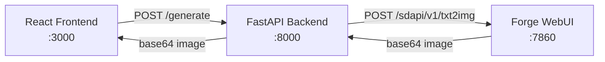

# KNOX AI

**A clean, chat-style frontend for Stable Diffusion WebUI Forge**

[](https://python.org)
[](https://nodejs.org)
[](https://fastapi.tiangolo.com)
[](https://react.dev)
[](LICENSE)

---

## 🎯 Overview

**KNOX AI** is a minimal, chat-inspired interface for AI image generation. It wraps Stable Diffusion WebUI Forge with a focused, distraction-free UI — type a prompt, get an image, repeat.

**Why KNOX?**
- Forge's native WebUI is feature-rich but cluttered
- Most users only need: *prompt → image → download*
- KNOX strips away tabs, accordions, and settings panels
- Decoupled architecture: swap the inference backend (Forge, A1111, ComfyUI) without touching the frontend

---

## 🏗 Architecture



| Component | Technology | Port | Responsibility |
|-----------|------------|------|----------------|
| **Frontend** | React 19 + Vite | 3000 | Chat UI, prompt history, image display |
| **Backend** | FastAPI + Uvicorn | 8000 | Proxy API, CORS, request validation |
| **Inference** | SD WebUI Forge | 7860 | Actual image generation via `/sdapi/v1/txt2img` |

---

## ✨ Features

- 💬 **Chat-style interface** — Prompt history in sidebar, generated images inline
- 🖼️ **Instant preview** — Base64 images render directly in chat
- ⬇️ **One-click download** — Save generated images instantly
- ⚡ **Loading states** — Visual feedback during generation
- 🔌 **Backend-agnostic** — Swap Forge for Automatic1111/ComfyUI by changing one URL
- ⚙️ **Configurable defaults** — Steps, resolution, sampler via backend

---

## 📋 Prerequisites

| Tool | Minimum Version | Notes |
|------|-----------------|-------|
| **Stable Diffusion WebUI Forge** | Latest | Must run with `--api --listen` on port 7860 |
| **Python** | 3.10+ | For FastAPI backend |
| **Node.js** | 18+ | For React frontend (Vite) |
| **Git** | 2.30+ | Version control |

> **Note:** Forge must be running *before* starting the KNOX backend.

---

## 🚀 Quick Start

### 1. Start Forge (Terminal 1)
```bash
cd stable-diffusion-webui-forge
./webui.sh --api --listen
# Windows: webui.bat --api --listen
```
Wait for: `Running on local URL:  http://127.0.0.1:7860`

### 2. Start Backend (Terminal 2)
```bash
cd backend
# Windows:
venv\Scripts\activate
# Linux/macOS:
source venv/bin/activate

uvicorn main:app --reload --port 8000
```
Verify: `http://127.0.0.1:8000/docs`

### 3. Start Frontend (Terminal 3)
```bash
cd frontend
npm install
npm run dev
```
Open: `http://127.0.0.1:3000`

---

## ⚙️ Configuration

### Backend (`backend/main.py`)
```python
# Forge API endpoint
FORGE_URL = "http://127.0.0.1:7860/sdapi/v1/txt2img"

# Generation defaults
DEFAULT_STEPS = 20
DEFAULT_WIDTH = 512
DEFAULT_HEIGHT = 512
```

### Frontend (`frontend/vite.config.js`)
```js
export default defineConfig({
  server: {
    proxy: {
      '/generate': 'http://127.0.0.1:8000'  // Avoid CORS in dev
    }
  }
})
```

### Environment Variables (Optional)
| Variable | Default | Description |
|----------|---------|-------------|
| `FORGE_URL` | `http://127.0.0.1:7860/sdapi/v1/txt2img` | Forge API endpoint |
| `BACKEND_PORT` | `8000` | FastAPI server port |
| `FRONTEND_PORT` | `3000` | Vite dev server port |

---

## 📡 API Reference

### Generate Image
```http
POST http://127.0.0.1:8000/generate
Content-Type: application/json

{
  "prompt": "cyberpunk city at sunset, neon lights, highly detailed"
}
```

**Response:**
```json
{
  "images": ["base64_encoded_png..."],
  "parameters": {
    "prompt": "cyberpunk city at sunset...",
    "steps": 20,
    "width": 512,
    "height": 512,
    "sampler_name": "Euler a"
  },
  "info": "{\"prompt\": \"...\", \"all_prompts\": [...], ...}"
}
```

**Error Response:**
```json
{ "error": "Connection refused - is Forge running on 7860?" }
```

---

## 📁 Project Structure

```
KNOX_AI/
├── backend/
│   ├── main.py              # FastAPI proxy server (46 lines)
│   ├── venv/                # Python virtual environment
│   └── requirements.txt     # (optional) pip dependencies
├── frontend/
│   ├── public/
│   │   ├── favicon.svg
│   │   └── icons.svg
│   ├── src/
│   │   ├── App.jsx          # Main chat UI component
│   │   ├── App.css          # Complete styling
│   │   ├── main.jsx         # React entry point
│   │   └── index.css        # Global styles
│   ├── package.json
│   ├── package-lock.json
│   ├── vite.config.js
│   └── README.md            # Vite template default
├── stable-diffusion-webui-forge/  # Submodule or separate clone
│   ├── webui.py
│   ├── webui.sh / webui.bat
│   └── ...                  # Forge internals
├── LICENSE                  # MIT License
└── README.md                # ← You are here
```

---

## 🖼️ Screenshots

| Chat Interface | Image Generation | Sidebar History |
|----------------|------------------|-----------------|
|  |  |  |

> **Add your screenshots to `docs/screenshots/` and they'll appear here automatically.**

---

## 🛠 Troubleshooting

| Issue | Cause | Fix |
|-------|-------|-----|
| `"Connection failed"` / `fetch` error | Backend not running | Start backend: `uvicorn main:app --port 8000` |
| `"Forge Status: 500"` / No image returned | Forge not ready / VRAM full | Check Forge terminal, restart with `--lowvram` |
| CORS errors in browser console | Frontend→Backend origin mismatch | Backend allows `*`, but verify `vite.config.js` proxy |
| `ModuleNotFoundError: fastapi` | Venv not activated | `source venv/bin/activate` (Linux/macOS) or `venv\Scripts\activate` (Windows) |
| Port already in use | Another process on 3000/8000/7860 | `lsof -ti:3000 \| xargs kill` or change ports |

---

## 🐳 Production Deployment (Optional)

### Docker Compose
```yaml
# docker-compose.yml
version: '3.8'
services:
  forge:
    build: ./stable-diffusion-webui-forge
    ports: ["7860:7860"]
    command: ["--api", "--listen", "--lowvram"]
    deploy:
      resources:
        reservations:
          devices:
            - driver: nvidia
              count: 1
              capabilities: [gpu]

  backend:
    build: ./backend
    ports: ["8000:8000"]
    environment:
      - FORGE_URL=http://forge:7860/sdapi/v1/txt2img
    depends_on: [forge]

  frontend:
    build: ./frontend
    ports: ["3000:80"]
    depends_on: [backend]
```

### Systemd (Linux Server)
```ini
# /etc/systemd/system/knox-backend.service
[Unit]
Description=KNOX AI Backend
After=network.target

[Service]
Type=simple
User=www-data
WorkingDirectory=/opt/knox/backend
ExecStart=/opt/knox/backend/venv/bin/uvicorn main:app --host 0.0.0.0 --port 8000
Restart=on-failure

[Install]
WantedBy=multi-user.target
```

---

## 🤝 Contributing

1. **Fork** the repository
2. **Create branch**: `git checkout -b feature/amazing-feature`
3. **Commit**: `git commit -m 'feat: add amazing feature'`
4. **Push**: `git push origin feature/amazing-feature`
5. **Open Pull Request**

### Code Style
- **Frontend**: ESLint + Prettier (`npm run lint`)
- **Backend**: Black + Ruff (`black main.py && ruff check main.py`)
- **Commits**: Conventional Commits (`feat:`, `fix:`, `docs:`, `refactor:`)

---

## 🗺 Roadmap

- [ ] **Batch generation** — Multiple images per prompt
- [ ] **Image-to-image** — Upload reference, generate variations
- [ ] **Model selector** — Switch checkpoints from UI
- [ ] **Parameter panel** — Steps, CFG, sampler, seed controls
- [ ] **Authentication** — Optional user accounts / API keys
- [ ] **Gallery view** — Grid of previous generations
- [ ] **Prompt templates** — Save/reuse prompt presets
- [ ] **Docker images** — Prebuilt containers for all services

---

## 📄 License

Distributed under the **MIT License**. See `LICENSE` for more information.

---

## 🙏 Acknowledgments

- **[Stable Diffusion WebUI Forge](https://github.com/lllyasviel/stable-diffusion-webui-forge)** — High-performance SD inference
- **[FastAPI](https://fastapi.tiangolo.com/)** — Modern, fast Python web framework
- **[React](https://react.dev/) + [Vite](https://vitejs.dev/)** — Frontend tooling
- **[Automatic1111](https://github.com/AUTOMATIC1111/stable-diffusion-webui)** — Original WebUI API design

---

<div align="center">

**Made with ❤️ for the Stable Diffusion community**

[Report Bug](https://github.com/yourusername/KNOX_AI/issues) · [Request Feature](https://github.com/yourusername/KNOX_AI/issues) · [Discussions](https://github.com/yourusername/KNOX_AI/discussions)

</div>